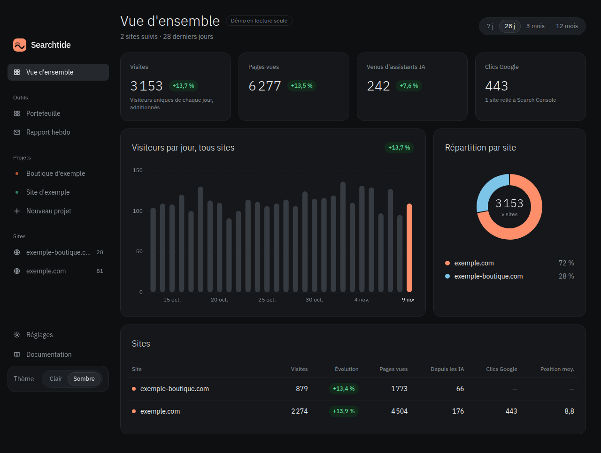
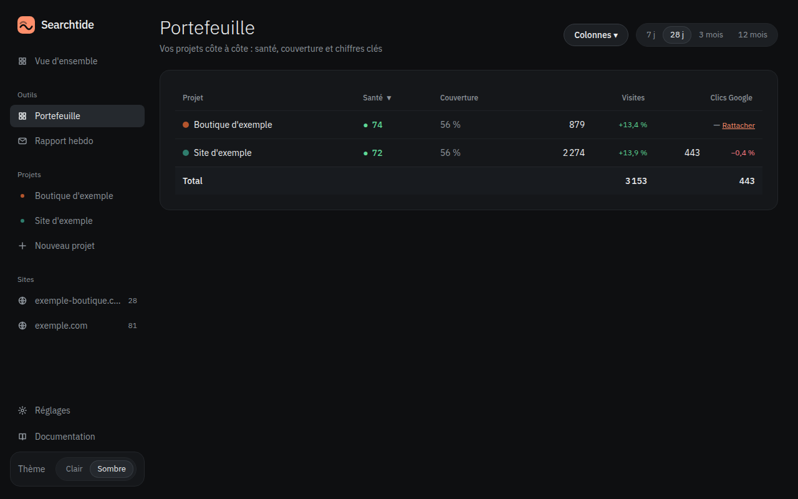

# Searchtide

Français : [README.md](README.md)

[](https://github.com/Nadir-DNA/searchtide/actions/workflows/ci.yml)
[](https://github.com/Nadir-DNA/searchtide/releases)
[](LICENSE)

**The self-hosted dashboard for people running several projects: cookie-less analytics, Search Console, Stripe and your own sources in one view, readable by your AI agents.**

One instance, one SQLite file, your keys encrypted on your machine. No hosted service, no telemetry.



## One-command demo

Fictional data, no keys, read-only:

```bash
docker run -d -p 127.0.0.1:3030:3030 -e DEMO=1 -v searchtide_demo:/data ghcr.io/nadir-dna/searchtide:0.2.2
```

Open <http://localhost:3030>. Details and a second screenshot (multi-project portfolio): [docs/demo.md](docs/demo.md).



## What it does

- **Several projects, one view.** Each project gathers its sources, its indicators and a health score; the Portfolio view compares them side by side.
- **Your keys stay with you.** Connection secrets are encrypted inside the instance (AES-256-GCM, key derived from `SECRET`) and are never returned by the API, including to agents.
- **Your agents read the numbers, not the keys.** An MCP server exposes the dashboard; connections remain reserved for the admin session.

## Installation

### Docker, one command

```bash
docker run -d --name searchtide -p 127.0.0.1:3030:3030 -v searchtide:/data ghcr.io/nadir-dna/searchtide:0.2.2
docker logs searchtide    # admin password generated on first start
```

No file to edit: `SECRET` and the password are generated on first start and kept in the `/data` volume. The password is shown only once — write it down.

Images for `linux/amd64` and `linux/arm64`, tags `0.2.0`, `v0.2.0` and `latest`.

### Docker Compose

```bash
docker compose up -d                    # builds the image locally
# or, with the published image:
docker compose pull && docker compose up -d --no-build
```

Compose binds the port to `127.0.0.1` by default. A `tunnel` profile (Cloudflare) is provided as an option.

### From source

Node 22.18 or newer (the server relies on native type stripping):

```bash
npm install
npm run build
npm start
```

## First run

The setup wizard has four steps, and each one only completes on real data: add a site and paste the tracking script, connect your services, create a project and attach its sources, then give an API key to an AI agent.

The tracking script goes in the site's `<head>`:

```html
<script defer src="https://your-instance/script.js" data-site="example.com"></script>
```

Custom events: `searchtide("signup")` in JavaScript, or the `data-searchtide="cta-click"` attribute on an element.

Connection error? See the [FAQ](docs/guides/faq.md) (in French): it covers the messages the app can display.

## The nine sources

Everything is configured in **Connections**: a short guide, the required fields, then "Test" — a connection is only saved if the test succeeds.

| Source | What it brings | Authentication | Guide |
|---|---|---|---|
| **Searchtide analytics** | Visits, pages, channels, referrers, countries, devices, campaigns, events, share of traffic coming from AI assistants | built in (tracking script) | [analytics](docs/guides/analytics.md) |
| **Google Search Console** | Clicks, impressions, CTR, position, opportunities; history kept beyond Google's 16 months. *Play is optional on the same connection:* daily installs, active installs, average rating | service account (JSON file); `gs://` bucket for Play | [google](docs/guides/google.md) |
| **Stripe** | Net revenue, MRR, active subscriptions, new customers | restricted `rk_` key (recommended) or **Connect with Stripe** (beta, test accounts, via Searchtide Connect) | [stripe](docs/guides/stripe.md) · [connect](docs/guides/stripe-oauth.md) |
| **Supabase** | users, signups, 7/30-day sign-ins, database size | read-only Postgres role + 4 aggregate functions | [supabase](docs/guides/supabase.md) |
| **Postgres** *(read-only)* | Any indicator you can compute in SQL: signups, activation, retention | URL of a read-only account; a single statement, run in `READ ONLY` | [postgres](docs/guides/postgres.md) |
| **SMTP / Gmail** | Weekly report and email alerts | Gmail app password, or any SMTP server | [smtp](docs/guides/smtp.md) |
| **ntfy** | Phone alerts | generated topic, copied into the ntfy app | [ntfy](docs/guides/ntfy.md) |
| **PageSpeed** | Performance score, SEO score, LCP, CLS | Google API key | [pagespeed](docs/guides/pagespeed.md) |
| **JSON API** | Any number exposed by a JSON URL | token, declared allowed domain | [api-json](docs/guides/api-json.md) |
| **Manual entry** | What has no API: followers, support requests | none | [manual entry](docs/guides/saisie-manuelle.md) |

**The per-connector guides are in French only for now.**

Indicators are only computed once the source is connected: the catalogue never advertises a number it cannot produce.

## AI agents (MCP)

Each agent gets **its own key** in **AI agents**: revocable, logged, and **read-only by default**. The server speaks Streamable HTTP on `/mcp`, with the key in the `Authorization` header.

```bash
# Claude Code
claude mcp add --scope user --transport http searchtide http://localhost:3030/mcp --header "Authorization: Bearer YOUR_KEY"
```

Any other "Streamable HTTP" MCP client:

```json
{ "mcpServers": { "searchtide": { "type": "http", "url": "http://localhost:3030/mcp", "headers": { "Authorization": "Bearer YOUR_KEY" } } } }
```

The tools cover reading (sites, traffic, Search Console, opportunities, projects and indicators, portfolio and health score, alerts, connections without secrets, pages, CRM and publications read-only, agent activity log) and, for a key that is not read-only, writing (indicators, Search Console sync, CRM, publications, pages). Neither secrets nor connection settings are returned to agents, and the anonymous demo has no access to MCP.

The REST API accepts the same key. A site id comes from `GET /api/sites`:

```bash
GET  /api/sites
GET  /api/sites/{id}/traffic?days=28
GET  /api/sites/{id}/search?days=28
POST /api/sites/{id}/sync
```

## Security

- **Encrypted vault**: secrets in AES-256-GCM, key derived from `SECRET` via HKDF; no API returns a full secret; only a short hint (prefix and last four characters) is shown. Rotating `SECRET` marks connections as "reconnect required" without losing history.
- **Three reading levels**: admin session, API or agent key, anonymous demo. Only the admin session sees settings and creates connections.
- **Sign-in**: 5 failures in 15 minutes block the IP address; TOTP two-factor authentication with `npm run 2fa`.
- **Backups**: consistent copy of the database every night around 02:00 UTC, 14 days for local copies (database, `secret`, `admin-password`). Off-site backup bundles (`.bundle.json.gz`) are **not** purged automatically: do it by hand.
- **Monitoring**: `GET /healthz`.

The instance is not a public service: keep the port on `127.0.0.1` and put it behind a TLS reverse proxy or the provided tunnel. With `DEMO=1`, reading is open but writing stays protected and connections are disabled.

## Data, backup and password

The `/data` volume holds the SQLite database, `secret` (the vault encryption key) and `admin-password` (generated on first start), the last two in clear text with permissions 600.

**Back up the whole `/data` volume.** A database restored without `secret` makes every connection undecryptable. The nightly backup includes all three. Restore:

```bash
node scripts/restore-backup.mjs <bundle> /data
```

Never attach this volume to a ticket or a support archive. Lost password: delete `admin-password` and restart.

## Known limitations

- Acceptance testing with real accounts covers Stripe, SMTP, Google Search Console and ntfy. Postgres is tested against a real server **locally only: those real tests are skipped in CI**. **PageSpeed, JSON API and Google Play have not been re-run against a real account** since this version.
- End-to-end tests run on Chromium only (no Firefox, no WebKit).
- **Connect with Stripe** is a **beta for test accounts only** (optional Searchtide Connect service): the restricted `rk_` key remains the recommended method for a real account.
- The interface and most documentation are in French.

## Roadmap

- **0.3**: Stripe OAuth in production (after platform account verification).
- **Later, no date**: deferred connectors (Cloudflare, Gmail read-only, third-party CRM, remote S3 backup).

## Contributing

Contributions are welcome: see [CONTRIBUTING.md](CONTRIBUTING.md) (in French). To report a vulnerability, do not open a public issue — use [SECURITY.md](SECURITY.md) (in French).

## License

MIT © Nadir DAOUDI. Third-party dependencies and fonts are all under permissive or OFL-1.1 licences; detailed inventory: [docs/licences.md](docs/licences.md).
