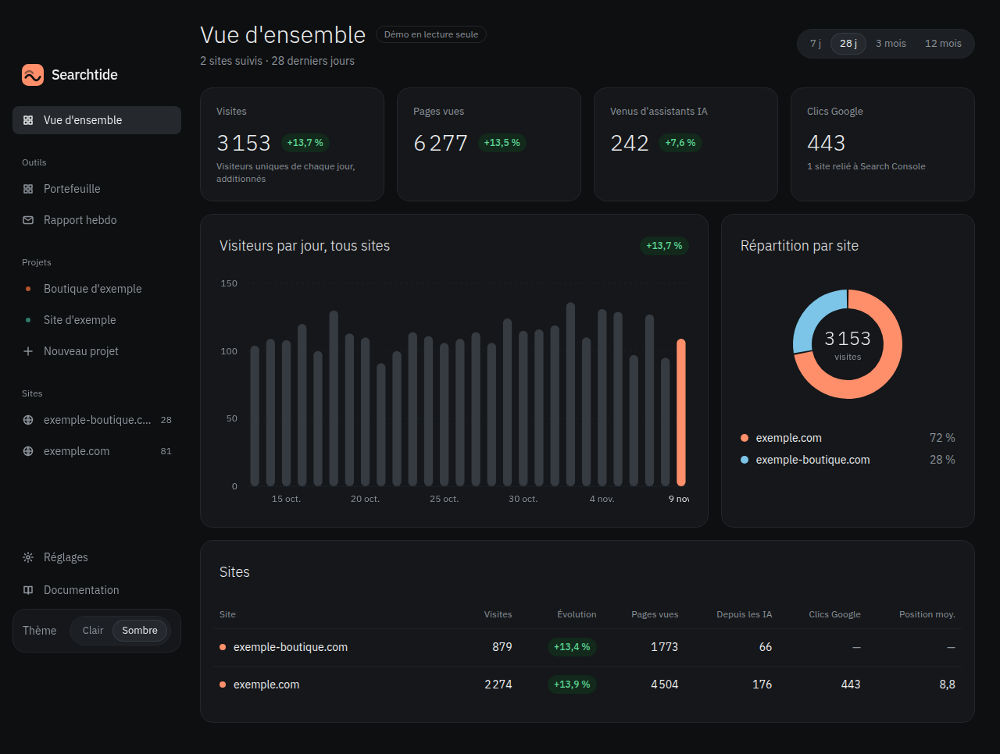
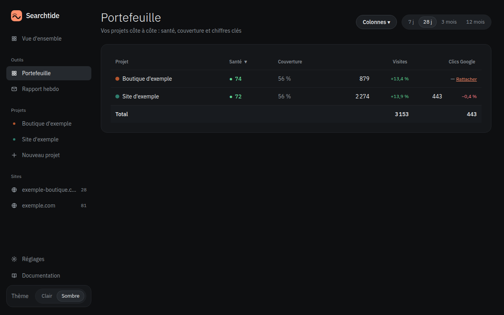

# Searchtide

English: [README.en.md](README.en.md)

[](https://github.com/Nadir-DNA/searchtide/actions/workflows/ci.yml)
[](https://github.com/Nadir-DNA/searchtide/releases)
[](LICENSE)

**Le tableau de bord auto-hébergé de celui qui gère plusieurs projets : analytics sans cookie, Search Console, Stripe et vos propres sources dans une seule vue, lisible par vos agents IA.**

Une instance, un fichier SQLite, vos clés chiffrées chez vous. Pas de service hébergé, pas de télémétrie.



## Démonstration en une commande

Données fictives, aucune clé, lecture seule :

```bash
docker run -d -p 127.0.0.1:3030:3030 -e DEMO=1 -v searchtide_demo:/data ghcr.io/nadir-dna/searchtide:0.2.0
```

Ouvrez <http://localhost:3030>. Détails et deuxième capture (portefeuille multi-projets) : [docs/demo.md](docs/demo.md).



## Ce que ça fait

- **Plusieurs projets, une vue.** Chaque projet rassemble ses sources, ses indicateurs et un score de santé ; la vue Portefeuille les compare côte à côte.
- **Vos clés restent chez vous.** Les secrets des connexions sont chiffrés dans l'instance (AES-256-GCM, clé dérivée de `SECRET`) et ne sont jamais renvoyés par l'API, y compris aux agents.
- **Vos agents lisent les chiffres, pas les clés.** Un serveur MCP expose le tableau de bord ; les connexions restent réservées à la session administrateur.

## Installation

### Docker, une commande

```bash
docker run -d --name searchtide -p 127.0.0.1:3030:3030 -v searchtide:/data ghcr.io/nadir-dna/searchtide:0.2.0
docker logs searchtide    # mot de passe administrateur généré au premier lancement
```

Aucun fichier à éditer : `SECRET` et le mot de passe sont générés au premier démarrage et conservés dans le volume `/data`. Le mot de passe n'est affiché qu'une fois — notez-le.

Images `linux/amd64` et `linux/arm64`, tags `0.2.0`, `v0.2.0` et `latest`.

### Docker Compose

```bash
docker compose up -d                    # construit l'image localement
# ou, avec l'image publiée :
docker compose pull && docker compose up -d --no-build
```

Compose lie le port à `127.0.0.1` par défaut. Un profil `tunnel` (Cloudflare) est fourni en option.

### Depuis les sources

Node 22.18 ou plus (le serveur utilise le type-stripping natif) :

```bash
npm install
npm run build
npm start
```

## Premier lancement

L'assistant d'installation compte quatre étapes, et chacune ne se valide que sur des données réelles : ajouter un site et coller le script de suivi, connecter ses services, créer un projet et lui rattacher ses sources, puis donner une clé à un agent IA.

Le script de suivi se colle dans le `<head>` du site :

```html
<script defer src="https://votre-instance/script.js" data-site="exemple.com"></script>
```

Événements personnalisés : `searchtide("inscription")` en JavaScript, ou l'attribut `data-searchtide="clic-cta"` sur un élément.

Une erreur de connexion ? Voir la [FAQ](docs/guides/faq.md) : elle reprend les messages que l'application peut afficher.

## Les neuf sources

Tout se configure dans **Connexions** : un guide court, les champs utiles, puis « Tester » — une connexion n'est enregistrée que si le test réussit.

| Source | Ce qu'elle apporte | Authentification | Guide |
|---|---|---|---|
| **Searchtide analytics** | Visites, pages, canaux, référents, pays, appareils, campagnes, événements, part du trafic venu d'assistants IA | intégrée (script de suivi) | [analytics](docs/guides/analytics.md) |
| **Google Search Console** | Clics, impressions, CTR, position, opportunités ; historique conservé au-delà des 16 mois de Google. *Play en option, même connexion :* installations par jour, installations actives, note moyenne | compte de service (fichier JSON) ; bucket `gs://` pour Play | [google](docs/guides/google.md) |
| **Stripe** | CA net, MRR, abonnements actifs, nouveaux clients | clé restreinte `rk_` en lecture seule — une clé complète `sk_` est refusée | [stripe](docs/guides/stripe.md) |
| **Postgres** *(lecture seule)* | Tout indicateur calculable en SQL : inscriptions, activation, rétention | URL d'un compte en lecture seule ; une seule instruction, exécutée en `READ ONLY` | [postgres](docs/guides/postgres.md) |
| **SMTP / Gmail** | Rapport hebdomadaire et alertes par e-mail | mot de passe d'application Gmail, ou un serveur SMTP | [smtp](docs/guides/smtp.md) |
| **ntfy** | Alertes sur le téléphone | sujet généré, à recopier dans l'application ntfy | [ntfy](docs/guides/ntfy.md) |
| **PageSpeed** | Score de performance, score SEO, LCP, CLS | clé API Google | [pagespeed](docs/guides/pagespeed.md) |
| **API JSON** | N'importe quel chiffre exposé par une URL JSON | jeton, domaine autorisé déclaré | [api-json](docs/guides/api-json.md) |
| **Saisie manuelle** | Ce qui n'a pas d'API : abonnés, demandes de support | aucune | [saisie manuelle](docs/guides/saisie-manuelle.md) |

Les KPI ne sont calculés qu'une fois la source branchée : le catalogue n'annonce pas de chiffre qu'il ne sait pas produire.

## Agents IA (MCP)

Chaque agent reçoit **sa propre clé** dans **Agents IA** : révocable, journalisée, et **en lecture seule par défaut**. Le serveur parle Streamable HTTP sur `/mcp`, avec la clé en en-tête `Authorization`.

```bash
# Claude Code
claude mcp add --scope user --transport http searchtide http://localhost:3030/mcp --header "Authorization: Bearer VOTRE_CLE"
```

Autre client MCP « Streamable HTTP » :

```json
{ "mcpServers": { "searchtide": { "type": "http", "url": "http://localhost:3030/mcp", "headers": { "Authorization": "Bearer VOTRE_CLE" } } } }
```

Les outils couvrent la lecture (sites, trafic, Search Console, opportunités, projets et indicateurs, portefeuille et score de santé, alertes, connexions sans secret, pages, CRM et publications en lecture, journal des agents) et, pour une clé qui n'est pas en lecture seule, l'écriture (indicateurs, synchronisation Search Console, CRM, publications, pages). Ni secret ni réglage de connexion n'est renvoyé, et la démonstration anonyme n'a pas accès au MCP.

L'API REST accepte la même clé. L'identifiant d'un site s'obtient avec `GET /api/sites` :

```bash
GET  /api/sites
GET  /api/sites/{id}/traffic?days=28
GET  /api/sites/{id}/search?days=28
POST /api/sites/{id}/sync
```

## Sécurité

- **Coffre chiffré** : secrets AES-256-GCM, clé dérivée de `SECRET` par HKDF ; aucune API ne renvoie un secret en entier ; seul un court indice (préfixe et 4 derniers caractères) est affiché. Une rotation de `SECRET` passe les connexions en « à reconnecter » sans perdre l'historique.
- **Trois niveaux de lecture** : session administrateur, clé d'API ou d'agent, démonstration anonyme. Seule la session administrateur voit les réglages et crée des connexions.
- **Connexion** : 5 échecs en 15 minutes bloquent l'adresse IP ; double authentification TOTP avec `npm run 2fa`.
- **Sauvegardes** : copie cohérente de la base chaque nuit vers 2 h UTC, 14 jours pour les copies locales (base, `secret`, `admin-password`). Les bundles de sauvegarde hors site (`.bundle.json.gz`) ne sont pas purgés automatiquement : à faire à la main.
- **Surveillance** : `GET /healthz`.

L'instance n'est pas un service public : gardez le port sur `127.0.0.1` et placez-la derrière un reverse proxy TLS ou le tunnel fourni. En `DEMO=1`, la lecture est ouverte mais l'écriture reste protégée et les connexions sont désactivées.

## Données, sauvegarde et mot de passe

Le volume `/data` contient la base SQLite, `secret` (clé de chiffrement du coffre) et `admin-password` (généré au premier lancement), ces deux derniers en clair et en droits 600.

**Sauvegardez tout `/data`.** Une base restaurée sans `secret` rend toutes les connexions indéchiffrables. La sauvegarde nocturne inclut les trois. Restauration :

```bash
node scripts/restore-backup.mjs <bundle> /data
```

Ne joignez jamais ce volume à un ticket ou à une archive de support. Mot de passe perdu : supprimez `admin-password` puis redémarrez.

## Limites connues

- La recette avec de vrais comptes couvre Stripe, SMTP, Google Search Console et ntfy. Postgres est testé contre un vrai serveur **en local seulement : ces tests réels sont ignorés en CI**. **PageSpeed, API JSON et Google Play n'ont pas été repassés sur un compte réel** depuis cette version.
- Les tests de bout en bout tournent sur Chromium uniquement (pas Firefox ni WebKit).
- La connexion Stripe en un clic (OAuth) n'existe pas encore : la clé restreinte `rk_` est la seule méthode.
- L'interface et l'essentiel de la documentation sont en français.

## Feuille de route

- **0.3** : connexion Stripe en un clic (OAuth) — conception écrite, aucun code à ce jour.
- **Ensuite, sans date** : connecteurs reportés (Cloudflare, Gmail en lecture, CRM tiers, sauvegarde distante S3).

## Contribuer

Les contributions sont bienvenues : voir [CONTRIBUTING.md](CONTRIBUTING.md). Pour signaler une faille, n'ouvrez pas d'issue publique — utilisez [SECURITY.md](SECURITY.md).

## Licence

MIT © Nadir DAOUDI. Les dépendances et polices tierces sont sous licence permissive ou OFL-1.1 ; inventaire détaillé : [docs/licences.md](docs/licences.md).
